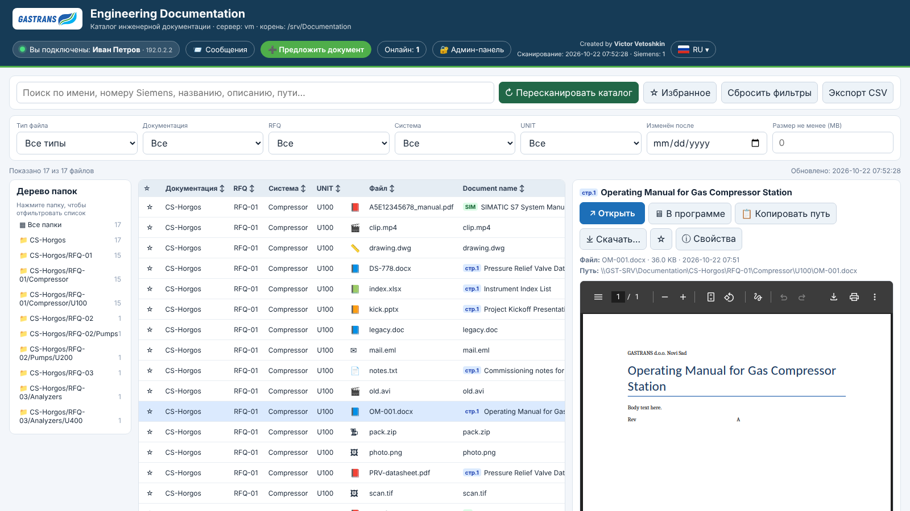
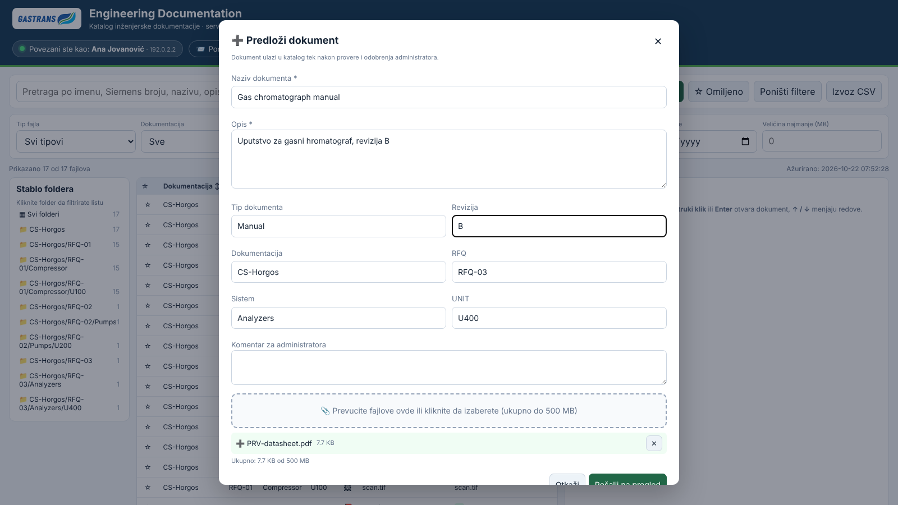
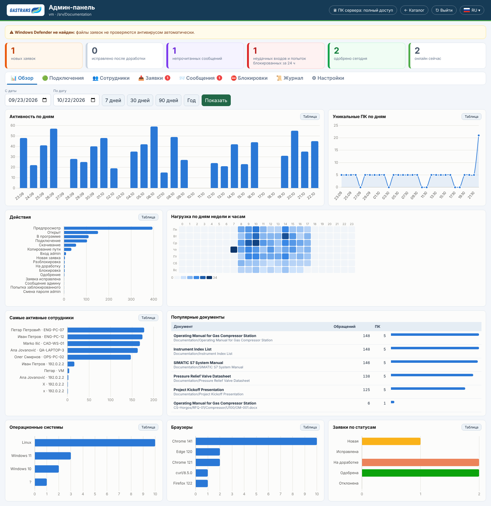
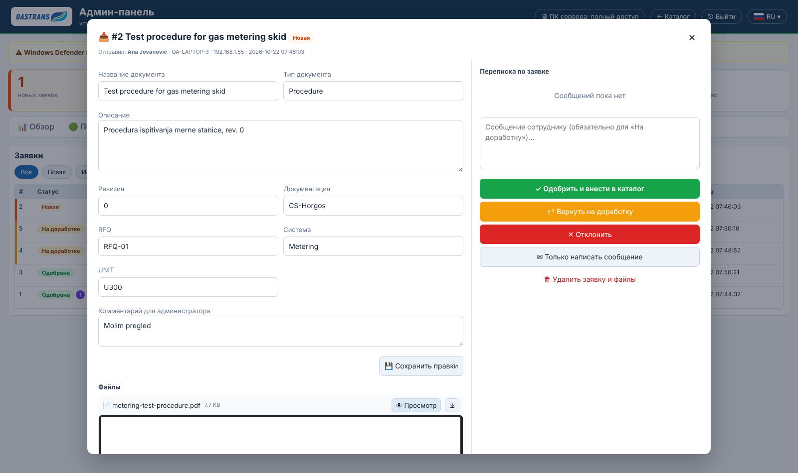
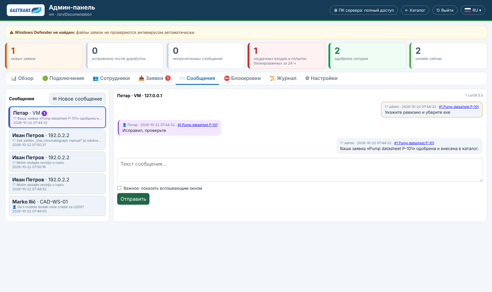

# GASTRANS Engineering Documentation

**English** · [Русский](README.ru.md)

A self-hosted web catalog for engineering documentation stored on a Windows PC. Employees on the local network browse, search and preview any document in the browser without downloading it. They can also submit new documents, which reach the catalog only after an administrator approves them. The administrator works from a password-protected dashboard with statistics, charts, messaging and device blocking.

The interface is available in Russian, Serbian (Latin) and English.



## Features

### For employees
- **Catalog**: table with search, sorting, a folder tree, filters (type, documentation, RFQ, system, unit, date, size), favorites and CSV export.
- **One-click opening**: double-click a row, press Enter, or use the **↗ Open** button at the top of the preview panel.
- **Preview of almost any file**:
  - PDF, images (TIFF is converted), video and audio (AVI/MKV/WMV through ffmpeg);
  - Word / Excel / PowerPoint / Visio / RTF / ODF through LibreOffice;
  - text, CSV, `.eml` e-mails, `.zip` contents.
- **Nothing is downloaded without consent**: a file is saved to the PC only after the **Download…** button and a confirmation.
- **In app**: opens the file in Word, Excel, AutoCAD and so on straight from the network share. Office files use `ms-word:` style links; for everything else there is an optional one-time helper.
- **Presence**: the header shows "Connected as: Name · PC-NAME". The PC name is detected automatically, no account is needed.
- **Document submissions**: a form with title, description, type, revision, target folder, comment and files (drag & drop, up to 500 MB by default). Rejected or returned submissions can be fixed and resent.
- **Messages**: an inbox with administrator messages (important ones appear as a pop-up) and replies.
- **Automatic titles**: for files without a Siemens mapping, the server reads the first page (PDF, DOCX, PPTX, XLSX, TXT) and shows the document title.

### For the administrator (`/admin`, account `admin`)
- **Colored cards**:
  - 🟧 new submissions
  - 🟦 resubmitted after changes
  - 🟪 unread messages
  - 🟥 failed sign-ins / blocked attempts
  - 🟩 approved today
  - online now
- **Charts**: activity per day, unique PCs, actions, a weekday × hour heatmap, most active employees, popular documents, operating systems, browsers, submissions by status. Every chart has a table view.
- **Connections and employees**: name, PC name, IP, OS (Windows 10 / 11 in Chrome and Edge), browser, screen, first and last visit, number of visits. A warning appears when different names were used from the same PC.
- **Submission review**:
  - preview of the submitted files and editing of the description;
  - approve, request changes with a message, reject or delete.
  - On approval the files are scanned with Windows Defender and copied into the catalog.
  - Approval works from any PC: the server process copies the files with its own Windows account, so the employees' share can stay read-only. Set `APPROVE_ONLY_ON_SERVER=1` to allow approval only on the server PC.
- **Blocking**: by IP, PC name and browser at once (a match on any of them blocks), with a reason and an optional end date. The server itself can never be blocked.
- **Messages** to any employee, as general messages or inside a submission thread.
- **Log** with filters by date, PC, employee, IP, action and document, plus CSV export.
- **Settings**: change the admin password, system status (LibreOffice, ffmpeg, Defender, network share, write permission, upload limits).

Everything is kept in `data/portal.db` (SQLite) and survives a restart: the log, devices, blocks, submissions, messages and the admin session.

| Submission form | Admin overview |
|---|---|
|  |  |
| **Submission review** | **Messages** |
|  |  |

## Requirements
- Windows 10/11 or Windows Server, **Python 3.10+**.
- Recommended: [LibreOffice](https://www.libreoffice.org/) for exact previews of Office documents.
- Optional: `ffmpeg.exe` in `C:\ffmpeg\bin\` for AVI / MKV / WMV.
- Windows Defender (built in) for scanning submitted files.

## Installation
1. Copy the `doc_portal` folder to the server PC.
2. Share `C:\Documentation` on the network (**read-only** for employees). The share name should be `Documentation`, otherwise change `DOC_SHARE`.
3. Check the settings in `start_windows.bat`.
4. Run `start_windows.bat`. On the first run it:
   - creates a virtual environment and installs the dependencies;
   - **asks for the `admin` password** (at least 6 characters). The password is stored only as a scrypt hash.
5. Allow inbound TCP 8080 in Windows Firewall for the Private/Domain profile.
6. Employees open `http://SERVER-NAME:8080`, the administrator opens `http://SERVER-NAME:8080/admin`.

To approve submissions, the Windows account running the server needs **write** permission on `C:\Documentation`.

## Start, stop, reset
| Task | How |
|---|---|
| Start | `start_windows.bat` |
| Stop | `Ctrl+C` in the server window, or close the window |
| Forgotten admin password | `reset_admin_password.bat` on the server |
| Change the password | Admin panel → Settings |
| Backup | Copy the `data` folder (database, submissions, preview cache) |

## Configuration (`start_windows.bat`)
| Variable | Default | Meaning |
|---|---|---|
| `DOC_ROOT` | `C:\Documentation` | Catalog folder |
| `DOC_META_DIR` | `C:\Documentation_ext` | Folder with `SIM_name.txt` / `SIM_number.txt` |
| `DOC_SHARE` | `\\%COMPUTERNAME%\Documentation` | UNC path of the same folder |
| `PORT` | `8080` | HTTP port |
| `UPLOAD_MAX_MB` | `500` | Size limit of one submission |
| `UPLOAD_EXTS` | built-in list | Allowed extensions, separated by spaces |
| `APPROVE_ONLY_ON_SERVER` | `0` | `1` allows approving submissions only on the server PC |
| `SOFFICE`, `FFMPEG` | auto | Paths if the tools are installed elsewhere |
| `DATA_DIR` | `.\data` | Database, submissions and cache |
| `TITLE_SCAN` | `1` | `0` turns off title detection |

## Security notes
- The app is intended for a **trusted local network**. Do not publish the port to the internet.
- Inside the network the traffic is plain HTTP, so do not reuse the admin password elsewhere.
- Employees are identified by browser + IP + PC name, not by Windows accounts. The name is typed by the employee.
- Brute force protection: after 5 failed sign-ins from one IP, signing in is locked for 15 minutes.
- Files that browsers cannot display are never served inline. Downloading always requires confirmation.

## Project structure
```
doc_portal/
├── app.py                    entry point (first-run password prompt, waitress server)
├── portal/
│   ├── config.py             settings and file type groups
│   ├── db.py                 SQLite schema and helpers
│   ├── catalog.py            scanning, Siemens mapping, title detection
│   ├── preview.py            previews and conversions (LibreOffice, ffmpeg, Pillow)
│   ├── clients.py            presence, devices, PC names, blocking, log
│   ├── auth.py               admin password and sessions
│   ├── submissions.py        submissions, Defender scan, messages
│   ├── routes_public.py      catalog pages and API
│   ├── routes_admin.py       admin panel and API
│   └── i18n.py               RU / SR / EN strings
├── templates/                Jinja templates
├── static/                   JS, CSS, flags, logo, Chart.js (bundled, works offline)
├── start_windows.bat
└── reset_admin_password.bat
```

Created by Victor Vetoshkin.
